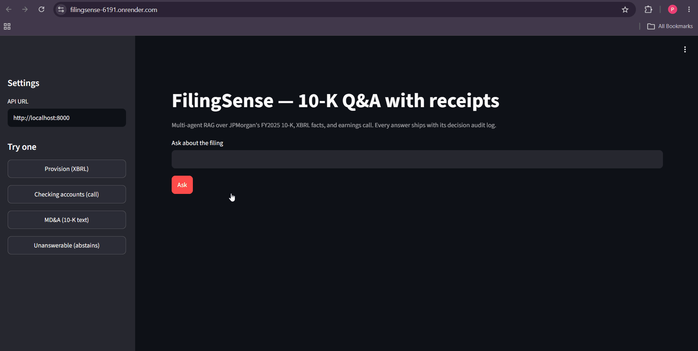

# FilingSense — 10-K Q&A with receipts

A multi-agent RAG system that answers questions about a real SEC 10-K filing — and ships the full decision audit log with every answer, not just the answer.



**Live demo:** https://filingsense-6191.onrender.com _(free-tier Render — cold start takes ~1–2 min if it's been idle)_

---

## The problem

A chatbot that answers finance questions from a document is easy to fake and easy to get wrong. The bar that actually matters for a compliance-adjacent use case isn't "does it sound right" — it's:

- Does it **refuse** when the answer isn't in the source, instead of guessing?
- Does every claim trace back to a specific chunk of evidence?
- Can you **measure** all of that, instead of eyeballing outputs?

FilingSense is built around that bar: JPMorgan's FY2025 10-K (text + structured XBRL facts) and Q4/FY2025 earnings call transcript, queried through a pipeline that gates, routes, retrieves, answers, and self-checks — with every one of those steps logged and scored against a 44-question golden set.

## Architecture

```
question
   │
   ▼
┌─────────────────────────┐   no + confident   ┌────────────────────────┐
│ Answerable gate  [Jev]   │ ─────────────────▶│ "Not in the filings."  │
└─────────────────────────┘                    └────────────────────────┘
   │ yes
   ▼
┌─────────────────────────┐
│  Router          [Jev]   │  → 10-K text | XBRL facts | earnings call
└─────────────────────────┘
   │
   ▼
┌─────────────────┐
│  Retrieve         │  hybrid: BM25 + dense (Qdrant), fused with RRF
└─────────────────┘
   │
   ▼
┌─────────────────┐
│  Analyst agent    │  answers from retrieved context only, cites chunks
└─────────────────┘
   │
   ▼
┌─────────────────────────┐  low confidence
│  Critic agent    [Jev]   │ ─────────────▶  escalated for review
└─────────────────────────┘
   │
   ▼
 final answer + full decision audit log
```

`[Jev]` marks every branch point handled by TypeSafe's Jev decision layer (typed, calibrated choice/score/yes-no — not free-text generation) rather than the Analyst/Critic LLMs. The Analyst is the only node that writes prose; everything else in the diagram is a typed decision.

**The decision layer.** Every branch point (answerable? which source? is this claim actually supported by what it cites?) is a typed, calibrated decision — not free-text generation. That's handled by [TypeSafe's Jev](https://typesafe.ai) ("System One" models: state + typed questions in, a choice/score/yes-no with a calibrated probability out, no token generation) sitting behind a swappable `DecisionGate` interface with a Gemini-structured-output fallback, so the pipeline never hard-depends on one vendor and the fallback doubles as the honest baseline Jev has to beat.

**The critic is a citation auditor, not an answer-checker.** It only ever sees the chunks the analyst cited — never the full evidence set — so a claim that's *true* but cites the wrong chunk still fails. Low-confidence verdicts escalate for review (the cascade pattern: cheap fast decisions first, scrutiny only where it's earned).

## Eval results (44-question golden set)

| Metric | Score |
|---|---|
| Answerability accuracy | **97.7%** |
| Abstention recall | **100%** |
| Routing accuracy | **97.0%** |
| Answer recall | **97.1%** |
| Critic faithfulness | 72.9% |
| Escalation rate | 27.1% |

Scored with a harness modeled on Ragas (faithfulness, precision/recall) plus custom gate-specific metrics (answerability, routing, abstention) — because "the shiny new decision layer" only means something if it's measured against the LLM fallback, not just used.

## Three bugs the eval caught (that eyeballing outputs wouldn't have)

1. **Rank-then-filter vs. filter-then-rank.** Call-transcript questions were abstaining systematically — the retriever ranked across the *full* corpus first, then filtered to the call, which threw away relevant chunks before they had a chance to rank. Fixed with a route-aware `search_within()` that filters first.
2. **Router drift on "how/why" questions.** The router had bare source names to choose from and kept sending explanatory questions to the wrong source. Fixed by giving the router full source descriptions instead of just labels.
3. **The measuring instrument was wrong, not the system.** The eval originally defined "abstained" as "the gate voted no" — but the pipeline is *designed* to continue past a low-confidence refusal rather than stop. Three of the four remaining "failures" were actually correct answers produced after an uncertain gate call. Fixed the metric, re-scored, and the re-score validated the `ABSTAIN_BELOW` confidence-threshold design with data instead of intent.

## Known limitations

- **Keyword recall (0.48)** on some free-text 10-K answers is lower than the other metrics — a handful of golden-set reference answers still need manual verification against the source text.
- **Gate latency runs ~4–5.6s per call**, well above TypeSafe's stated 70–500ms — Jev is accessed through a third-party proxy rather than direct, which adds a real latency tax. Fine for a portfolio-scale pipeline, worth knowing before scaling call volume.
- **Single filer, single fiscal year.** The pipeline is source-agnostic by design (XBRL tags, route descriptions, and the retriever all take a company/FY as parameters) but only JPMorgan FY2025 is loaded right now.

## Tech stack

`LangGraph` (agent orchestration) · `Qdrant` + `BM25` (hybrid retrieval, RRF fusion) · `TypeSafe Jev` + `Gemini` fallback (decision layer) · `FastAPI` + `Streamlit` (serving) · `Docker` → `Render` (deploy) · SEC EDGAR + XBRL (data)

## Running it locally

```bash
cp .env.example .env        # fill in your keys — see .env.example for what's needed
docker compose up -d        # Qdrant
pip install -r requirements.txt
python -m uvicorn filingsense.api:app --port 8000 &
streamlit run streamlit_app.py
```

## What I'd improve at scale

- Move BM25 from in-memory to Qdrant's native sparse vectors once the corpus grows past a handful of filings.
- Add a per-chunk reranking gate call — deliberately skipped here because at ~4.5s/decision it would cost roughly a minute per query; worth revisiting if gate latency comes down.
- Multi-filer, multi-year support: generalize the XBRL tag map and router descriptions beyond the current single-company scope.
